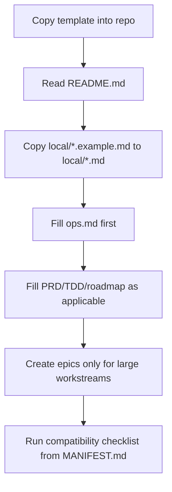
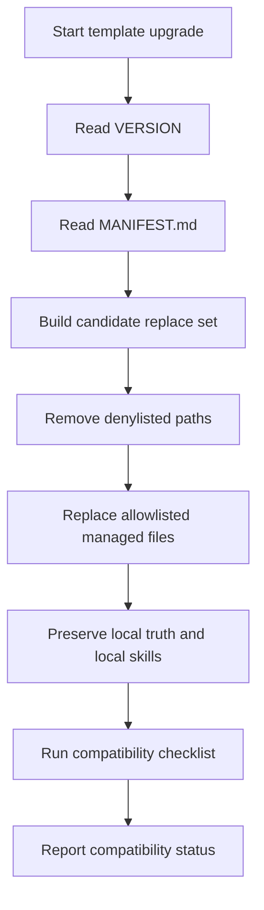

<!--
Managed by repo-governance template.
Replaceable during template upgrades.
Do not edit in consuming repos.
Repo-specific specialization belongs in docs/governance/local/*.
-->
# Repo Governance

Repo-governance v2.2.3 是給 AI-assisted repo 使用的完整治理套件。

它不是輕量 template；它是可升級的 repo 憲法系統：

- `AGENTS.md` 管不可違反的硬邊界。
- `MANIFEST.md` 管 template 怎麼升級。
- `managed/*` 管可被 template 升級替換的治理規則。
- `local/*` 管 consuming repo 自己的 durable truth。
- `.agents/skills/*` 管 runtime control skill 的輸出格式與操作程序。

核心原則：

- Managed files 是 template-owned，可在升級時替換。
- Local files 是 repo-owned truth，升級時不可覆蓋。
- Local files 可以強化或特化治理規則，但不可削弱 hard gates。
- Runtime artifacts 預設不是 canonical，除非明確 promoted 到 local truth。
- `docs/governance/MANIFEST.md` 是 upgrade 與 compatibility contract 的唯一 owner。

## 架構

v2.2.3 有兩條使用路徑、三層責任、五個 managed rule owners、六個 managed control skills。

### 兩條使用路徑

#### Agent 日常執行路徑

Agent 做一般任務時，不應該讀完整個 governance folder。先從 `AGENTS.md` 進入，再只讀跟任務相關的 managed docs 與 local truth。

```text
AGENTS.md
  -> docs/governance/README.md
  -> only relevant managed docs
  -> only relevant local truth
```

常見例子：

```text
一般 code / docs change:
AGENTS.md
-> docs/governance/managed/process.md
-> docs/governance/local/tdd.md, if technical truth is needed
-> docs/governance/managed/verification.md before completion

release / deploy / destructive action:
AGENTS.md
-> docs/governance/local/ops.md
-> docs/governance/managed/release.md
-> .agents/skills/release-gate/SKILL.md

requirement / product change:
AGENTS.md
-> docs/governance/local/prd.md
-> docs/governance/local/roadmap.md or local/epics/, if tracked
-> docs/governance/managed/doc-sync.md
```

#### Template 維護 / 升級路徑

升級 repo-governance template 時，`MANIFEST.md` 是 contract。

```text
docs/governance/VERSION
  -> docs/governance/MANIFEST.md
  -> upgrade allowlist / denylist
  -> compatibility checklist
```

`MANIFEST.md` 是下列事項的唯一 owner：

- upgrade allowlist
- upgrade denylist
- initialization-only files
- required files
- header requirements
- compatibility checklist

### 三層責任

```text
Layer 1: Entry and hard gates
- AGENTS.md

Layer 2: Managed governance modules
- docs/governance/managed/process.md
- docs/governance/managed/verification.md
- docs/governance/managed/release.md
- docs/governance/managed/subagents.md
- docs/governance/managed/doc-sync.md

Layer 3: Repo-owned local truth
- docs/governance/local/ops.md
- docs/governance/local/prd.md
- docs/governance/local/tdd.md
- docs/governance/local/roadmap.md
- docs/governance/local/epics/
```

已合併的舊 managed modules：

```text
docs/governance/managed/terminology.md -> merged into managed/process.md
docs/governance/managed/completion.md  -> merged into managed/verification.md
```

### Managed rule owners（規則 owner）

| 關注點 | 負責檔案 |
|---|---|
| Task classes, planning threshold, runtime artifacts, canonical lookup | `docs/governance/managed/process.md` |
| Verification, completion taxonomy, reports, commit rules | `docs/governance/managed/verification.md` |
| Release-sensitive, destructive, production-data, human checkpoint gates | `docs/governance/managed/release.md` |
| Subagent delegation boundaries | `docs/governance/managed/subagents.md` |
| PRD / TDD / roadmap / epics / ops sync | `docs/governance/managed/doc-sync.md` |

## 權威邊界

| 關注點 | 負責檔案 |
|---|---|
| Entry, hard gates, domain-based source lookup | `AGENTS.md` |
| Version | `docs/governance/VERSION` |
| 升級 allowlist、denylist、required files、compatibility | `docs/governance/MANIFEST.md` |
| Commands, environments, model policy, release constants | `docs/governance/local/ops.md` |
| Product behavior and acceptance | `docs/governance/local/prd.md` |
| Technical design and boundaries | `docs/governance/local/tdd.md` |
| Priority and sequencing | `docs/governance/local/roadmap.md` |
| Large workstream details | `docs/governance/local/epics/*` |
| Runtime control output schemas and procedures | template-managed control skills under `.agents/skills/{runtime-adapter,subagent-routing,verifier,release-gate}/` |
| Repo-specific expert invariants | repo-owned expert skills under `.agents/skills/*`, excluding managed control skills |

## 日常查找表

從 `AGENTS.md` 開始，然後只讀任務需要的最小文件集。不要預設讀完整個 governance folder。

| 需求 | 讀取 |
|---|---|
| task class、planning threshold、runtime artifacts、canonical lookup | `docs/governance/managed/process.md` |
| verification、completion status、report format、commit rules | `docs/governance/managed/verification.md` |
| release-sensitive、destructive、production-data、human checkpoint gates | `docs/governance/managed/release.md` |
| subagent delegation boundaries | `docs/governance/managed/subagents.md` |
| doc sync、stale docs | `docs/governance/managed/doc-sync.md` |
| repo commands、environment、model policy、release constants | `docs/governance/local/ops.md` |
| product behavior、UI / UX、acceptance | `docs/governance/local/prd.md` |
| technical design、architecture、API / data contracts | `docs/governance/local/tdd.md` |
| priority、Now / Next / Later / Done / Parked | `docs/governance/local/roadmap.md` |
| large workstream requirement details | `docs/governance/local/epics/` |
| template upgrade / compatibility | `docs/governance/MANIFEST.md` |

## 初始化

第一次把這個 template 複製到 repo 時，只複製 examples 來建立 repo-owned local files：

```text
docs/governance/local/ops.example.md           -> docs/governance/local/ops.md
docs/governance/local/prd.example.md           -> docs/governance/local/prd.md
docs/governance/local/tdd.example.md           -> docs/governance/local/tdd.md
docs/governance/local/roadmap.example.md       -> docs/governance/local/roadmap.md
docs/governance/local/epics/README.example.md  -> docs/governance/local/epics/README.md
```

初始化後，真實的 `docs/governance/local/*` 是 repo-owned truth。template 升級時不可覆蓋。

`.example.md` files belong to the source template package. An initialized consuming repo may omit them after the matching repo-owned local files exist.

`ops.md` 建議先填，因為 commands、environment、model policy、release constants 會影響 agent 怎麼驗證與執行。

只有大型 workstream 需要 child requirement tracking、source history、multi-session delivery 或 evidence history 時，才建立 epic file：

```text
docs/governance/local/epics/E-001-<topic>.md
```

空 section、placeholder、未填欄位都代表 `unknown`，不是 accepted truth。

### 初始化 flow



## Local truth 職責

- `ops.md`：commands、environments、release process、model policy、operator notes path。
- `prd.md`：accepted product behavior、UI / UX decisions、user-facing flows、acceptance criteria。
- `tdd.md`：accepted technical design、architecture boundaries、API contracts、data models、verification strategy。
- `roadmap.md`：Now / Next / Later / Done / Parked 的 priority dashboard。
- `epics/`：大型 workstream 的 requirement ledger。

分工規則：

- Roadmap 決定 sequencing。
- Epics 追 workstream details。
- PRD 擁有最終 accepted product truth。
- TDD 擁有最終 accepted technical truth。
- Ops 擁有 repo-specific operational truth。
- Operational matters 一律以 `ops.md` 為準；roadmap、epic、plan 或歷史文件裡的舊 command / deploy / migration 說法不得覆蓋 ops。
- Roadmap 或 epic 若跟該 domain owner（PRD / TDD / Ops）衝突，較低權威來源視為 stale，meaningful completion claim 前必須同步或標記 blocker。

## Control skills 職責

Control skills 是 template-owned，要 schema 自含，但 policy 引用 managed docs；不要在 skill 裡重寫整套治理規則。

| Skill | 用途 | 政策來源 |
|---|---|---|
| `.agents/skills/runtime-adapter/SKILL.md` | 任務開始時回傳 governance refs、hard gates、local truth boundaries 與 local context entrypoints。 | `AGENTS.md`, `README.md`, `managed/process.md`, `MANIFEST.md` |
| `.agents/skills/verifier/SKILL.md` | meaningful change / completion claim 前做獨立驗證。 | `managed/verification.md`, `managed/doc-sync.md`, `managed/release.md`, `local/ops.md` |
| `.agents/skills/release-gate/SKILL.md` | release-sensitive / destructive environment action 前做 `go` / `hold` / `require-human` 判定。 | `managed/release.md`, `local/ops.md`, `managed/verification.md` |
| `.agents/skills/subagent-routing/SKILL.md` | explicit plan / task list 出現後，分類任務為 inline、delegable、main-runtime-only 或 blocked。 | `managed/subagents.md`, `managed/process.md`, `managed/verification.md`, `managed/release.md` |
| `.agents/skills/drift-repair/SKILL.md` | 修復 roadmap、epic、PRD、TDD、ops 之間的 stale status、錯誤引用與證據不一致。 | `managed/doc-sync.md`, `managed/process.md`, `managed/verification.md`, `local/roadmap.md`, `local/epics/` |
| `.agents/skills/decision-advisor/SKILL.md` | promotion 前萃取 human decisions、recommended defaults、missing specialist capabilities，避免 unresolved assumptions 變成 accepted truth。 | `managed/process.md`, `managed/doc-sync.md`, `local/prd.md`, `local/tdd.md`, `local/epics/` |

Repo-specific expert skills 可存在於 `.agents/skills/<skill-name>/SKILL.md`，但不包含上述 managed control skills。這些 expert skills 是 consuming repo-owned，template upgrade 不可覆蓋；`runtime-adapter` 需讀取 frontmatter 並選擇本次任務相關的 expert skills。

## 升級

升級 repo-governance template 時：

1. 讀 `docs/governance/VERSION`。
2. 讀 `docs/governance/MANIFEST.md`。
3. 只替換 manifest allowlist 允許的 paths。
4. 移除所有 denylist paths。
5. 不要用 `.example.md` 覆蓋已初始化的 local files。
6. 保留 repo-owned local truth、`.agents/skills/local/*`、repo-owned expert skills 與 legacy repo-owned docs。
7. 跑 `MANIFEST.md` 裡的 compatibility checklist。

如果 path 沒有明確允許自動覆蓋，預設不要覆蓋。

### 升級 flow



## 相容性檢查

聲稱 repo 使用 governance v2.2.3 前，依 `docs/governance/MANIFEST.md` 的 compatibility checklist 檢查。

最少要確認：

- `AGENTS.md` 存在並指向 `docs/governance/*`。
- `VERSION` 是 `2.2.3` 或更新。
- `MANIFEST.md` 存在且是 upgrade contract owner。
- 五個 managed modules 都存在。
- 六個 managed control skills 都存在。
- 初始化後的 repo local files 存在。
- managed / repo-owned headers 符合 manifest 要求。
- repo-owned expert skills 若存在，仍保留且沒有被 template-owned control skill allowlist 覆蓋。
- upgrade denylist 排除 `docs/governance/local/*` 與 `.agents/skills/local/*`。
- Roadmap 不複製完整 epic child requirement text。
- Epics 不聲稱 override PRD、TDD、hard gates 或 roadmap priority。
- 空 local sections 與 placeholders 被視為 `unknown`，不是 accepted truth。

若是在驗證 source template package 本身，才額外確認 local examples 存在且 example headers 符合 manifest。已初始化 consuming repo 不需要 vendor `.example.md` files。

## 舊版相容

有些 repo 可能已經有舊版 repo-owned docs，例如：

```text
docs/prd.md
docs/tdd.md
docs/requirements/*
```

這些檔案預設不可被 template upgrade 覆蓋，除非人類明確執行 migration。

若要完整採用 v2，將 active product、technical、priority、workstream truth 搬到 `docs/governance/local/*`，再把舊文件標記為 stale 或 archived。
